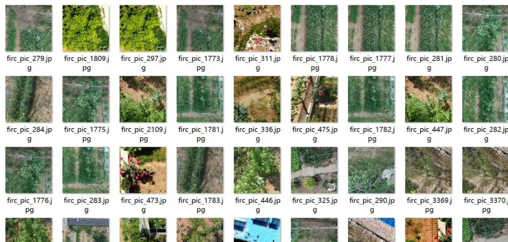
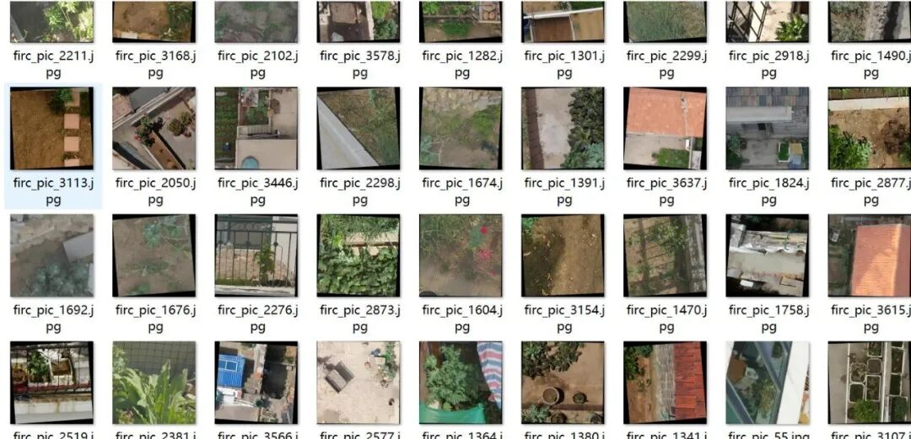
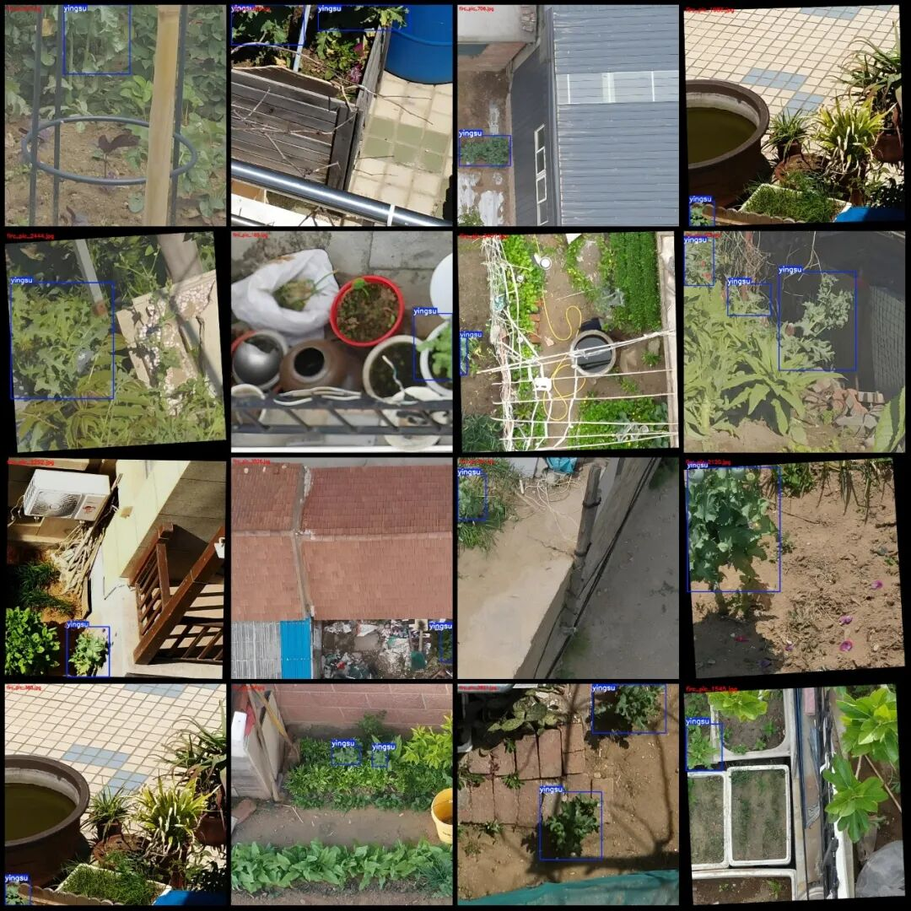
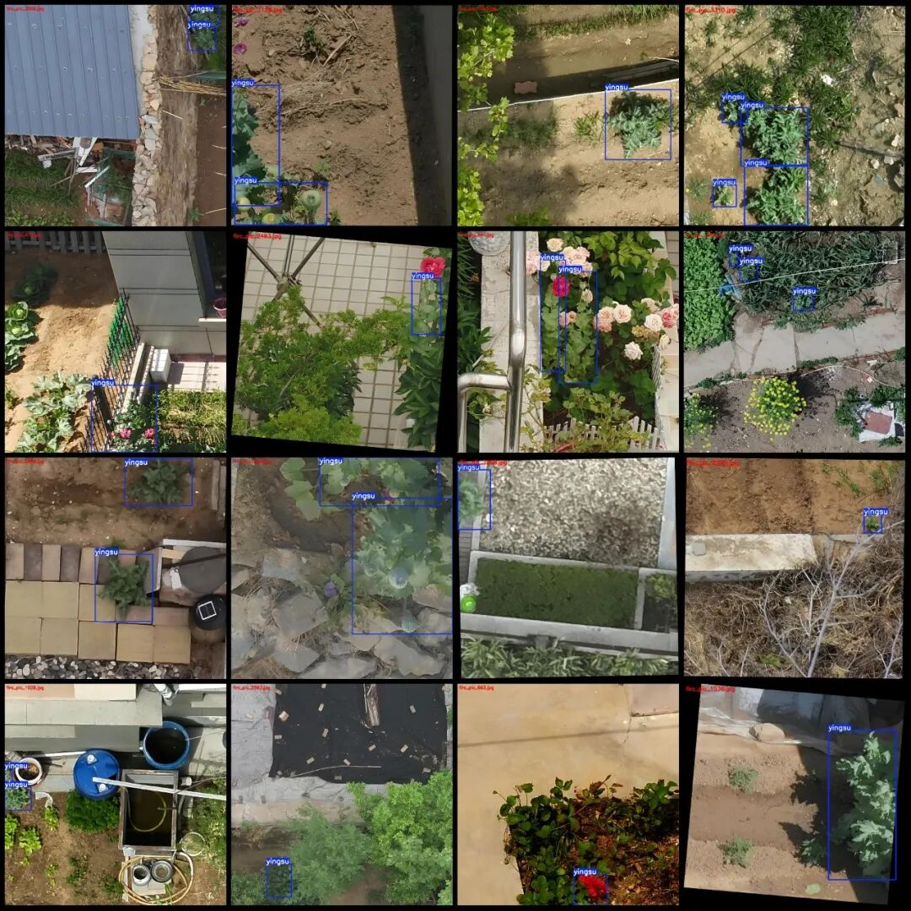

# Drone-View Phyllodyne Detection Dataset VOC+YOLO format with 3648 images in 1 category

Please note that the dataset contains primarily rotation-enhanced images, which account for about half of the data volume. Please review the images carefully.

Dataset format: Pascal VOC format + YOLO format (txt file without split path, only containing jpg images and corresponding VOC format xml files and yolo format txt files)

Number of images (number of jpg files): 3648

Number of annotations (number of xml files): 3648

Number of annotations (number of txt files): 3648

Label category count: 1

Label category name: ["yingsu"]

Number of boxes labeled in each category:

Yingsu Frame Count = 6066

Total frame count: 6066

Number of images per category:

Yingsu's possession of images = 3648

Image resolution: Multi-resolution images, such as 988x988, 1280x1280, etc.

Using labelImg:

Annotation rules: Draw a rectangle around the category.

Important Notice: The dataset does not have separate training, validation, and test sets; you need to partition them yourself.

Special : This dataset does not guarantee the accuracy of the trained models or weight files.

Image Preview:

Annotation example:

## Payment

Here is a pay link on Stripe ( https://buy.stripe.com/3cs8yP7sY87d0vu9AB ). Please contact me lonlonago@foxmail.com after funding $89, and I will send you a complete data files , thank you!

